# AOCS Scheduling

The AOCS components of the `example-std` application run in one thread with a fixed schedule.
The devices and the controller have timing requirements among each other:

- The magnetometers (MGMs) should measure while the magnetorquer (MTQ) is inactive.
- The controller runs after the MGMs, so it uses fresh measurements. It always starts at the
  same offset from the cycle start, even if the MGMs are done earlier. This deterministic timing
  is a favorable property for control algorithms.
- The MTQ runs right after the controller, so its commands are applied immediately.
- The MTQ field needs some time to drop after torquing ends.

Each component gets a slot with a fixed offset from the cycle start. The offsets are defined in
the `config::tasks::aocs` module of the `example-std` application.

## One cycle

The subsystem and the MGM assembly are software components. They run at the start of the cycle,
so their mode commands reach the devices in the same cycle. The assembly runs a second time after
the MGM handlers to collect their mode reports.

```mermaid
gantt
    title AOCS cycle (400 ms)
    dateFormat x
    axisFormat %-L ms
    tickInterval 50millisecond
    todayMarker off

    section Software
    Subsystem               : 0, 5
    MGM assembly (commands) : 5, 10
    MGM assembly (reports)  : 30, 35

    section Sensors
    MGM 0                   : 10, 20
    MGM 1                   : 20, 30

    section Control
    Controller slot         : milestone, 100, 100
    Controller              : 100, 140

    section Actuators
    MTQ                     : 140, 150
    Torque                  : active, 150, 370
    Field drop              : crit, 370, 400
```

## Two cycles

The torque and the field drop must end before the MGMs measure in the next cycle. With a 400 ms
cycle and the MTQ running at around 150 ms, this leaves about 250 ms for both.

```mermaid
gantt
    title Two AOCS cycles
    dateFormat x
    axisFormat %-L ms
    tickInterval 100millisecond
    todayMarker off

    section Sensors
    MGMs (cycle 1)       : 0, 35
    MGMs (cycle 2)       : 400, 435

    section Control
    Controller (cycle 1) : 100, 140
    Controller (cycle 2) : 500, 540

    section Actuators
    MTQ (cycle 1)        : 140, 150
    Torque (cycle 1)     : active, 150, 370
    Field drop (cycle 1) : crit, 370, 400
    MTQ (cycle 2)        : 540, 550
    Torque (cycle 2)     : active, 550, 770
    Field drop (cycle 2) : crit, 770, 800
```

## Slot overrun

Both MGM handlers wait up to 50 ms for a reply. If neither device answers, the MGM block takes
the whole 100 ms and the controller starts late. The schedule logs a warning and runs the
controller and the MTQ right away. The next cycle still starts at its planned time.

```mermaid
gantt
    title MGM timeouts delay the controller
    dateFormat x
    axisFormat %-L ms
    tickInterval 50millisecond
    todayMarker off

    section Software
    Subsystem, assembly : 0, 10

    section Sensors
    MGM 0 (timeout)     : crit, 10, 60
    MGM 1 (timeout)     : crit, 60, 110

    section Control
    Planned start       : milestone, 100, 100
    Controller (late)   : active, 110, 150

    section Actuators
    MTQ (late)          : active, 150, 160
```

