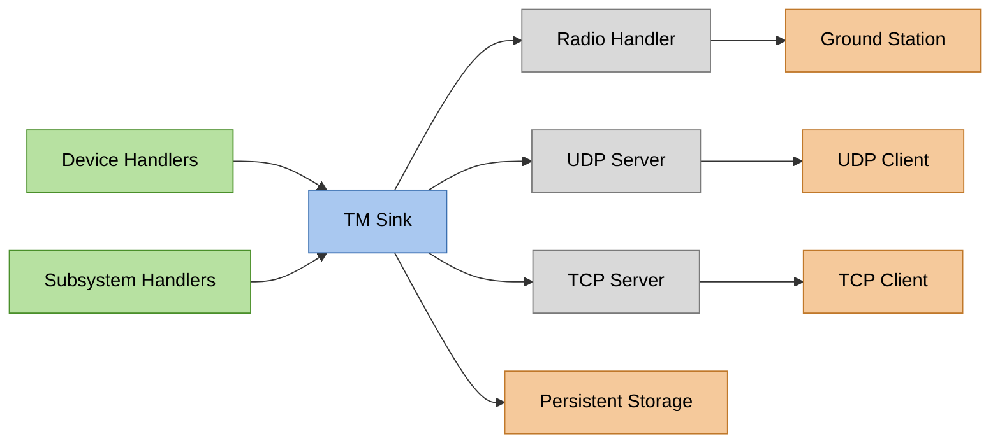
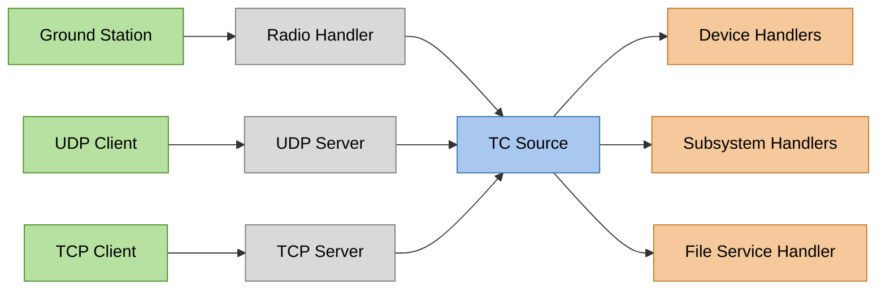

# Communication with Space Systems

Communication is a vital topic for remote systems which are usually not (directly)
connected to the internet and only have 1-2 communication links during nominal operation. However,
most of these systems have internet access during the development cycle. There are various standards
provided by CCSDS which can be useful to determine how to communicate with the satellite
and the primary On-Board Software.

Most communication with space systems is packet based. The `sat-rs` library provides some support
for the [CCSDS space packet protocol](https://ccsds.org/Pubs/133x0b2e2.pdf), which the
[Packet Format and TMTC Modelling](./tmtc-modelling.md) chapter describes in detail.

1. [UDP TMTC Server](https://docs.rs/satrs/latest/satrs/hal/std/udp_server/index.html).
   UDP is already packet based which makes it an excellent fit for exchanging space packets.
2. [TCP TMTC Server Components](https://docs.rs/satrs/latest/satrs/hal/std/tcp_server/index.html).
   TCP is a stream based protocol, so the library provides building blocks to parse telecommands
   from an arbitrary bytestream. Two concrete implementations are provided:
    - [TCP spacepackets server](https://docs.rs/satrs/latest/satrs/hal/std/tcp_server/struct.TcpSpacepacketsServer.html)
      to parse tightly packed CCSDS Spacepackets.
    - [TCP COBS server](https://docs.rs/satrs/latest/satrs/hal/std/tcp_server/struct.TcpTmtcInCobsServer.html)
      to parse generic frames wrapped with the
      [COBS protocol](https://en.wikipedia.org/wiki/Consistent_Overhead_Byte_Stuffing).

# Working with telemetry and telecommands (TMTC)

The commands sent to a space system are commonly called telecommands (TC) while the data received
from it are called telemetry (TM). One way to model the packet handling, which can be applied to most
satellites, is to introduce the concept of a TC source and a TM sink. The TM sink is the one entity where
all generated telemetry arrives in real-time. The most important task of the TM sink usually is to
send all arriving telemetry to the ground segment of a satellite mission immediately.

Another important task might be to store all arriving telemetry persistently. This is especially
important for space systems which do not have permanent contact like low-earth-orbit (LEO)
satellites.

The diagram below shows an example of how the packet flow could look:

<figure>

<figcaption>
Figure 1: Example TM packet flow. Arrows point in the direction the telemetry packets travel.
Green nodes create packets, grey nodes only transport them and orange nodes receive them.
The blue node is the central TM sink.
</figcaption>
</figure>

The most important task of a TC source is to deliver the telecommands to the correct recipients.
For component oriented software using message passing, this usually includes demultiplexing
to determine where a command needs to be sent.

The diagram below shows one concrete example of how the packet flow could look.

<figure>

<figcaption>
Figure 2: Example TC packet flow. Arrows point in the direction the telecommands travel.
Green nodes create telecommands, grey nodes only transport them and orange nodes receive them.
The blue node is the central TC source.
</figcaption>
</figure>

Using a generic concept of a TC source and a TM sink as part of the software design simplifies
the flexibility of the TMTC infrastructure: Newly added TM generators and TC receivers only have to
forward their generated or received packets to those handler objects.
