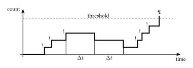

# Fault Detection, Isolation And Recovery (FDIR)

Operators only have limited contact with a spacecraft, usually during short ground passes.
Flight software must therefore be able to detect failures and critical events on its own and
ideally recover from them, or at least keep the system in a safe state until the next contact.

Every autonomous action also needs to be observable by operators. The system should leave a
paper trail, for example in the form of events, so operators can later figure out what happened
and why.

FDIR should also not become too smart. Complex FDIR logic is hard to understand and verify, and
it might interfere with regular commanded operations.

We will introduce some basic concepts that are important for the actual implementation of FDIR
in a system first. Then we will walk through the individual steps of FDIR and map that to concrete
relevant examples.

## Health

Health is an important concept for systems and components which might fail.
Oftentimes, the health is tied to the mode of a system component in some shape or form, and
determines whether a system component is usable. Health is also an extremely useful model
to simplify the FDIR concept of a system.

The following health states are based on the ones used inside the FSFW and are enough to model most
use cases:

- `HEALTHY`
- `FAULTY`
- `NEEDS RECOVERY`
- `EXTERNAL CONTROL`

1. `HEALTHY` means that a component is working nominally, and can perform its task without any
   issues.
2. `FAULTY` means that a component does not work properly. This might also impact other system
   components, so the passivation and isolation of that component is desirable for FDIR purposes.
3. `NEEDS RECOVERY` is used to attempt a recovery of a component. For example, a simple sensor
   could be power-cycled if there were multiple communication issues recently.
4. `EXTERNAL CONTROL` is used to isolate an individual component from the rest of the system. For
   example, an operator might be interested in testing a component in isolation, and the
   interference of the system is not desired. In that case, the `EXTERNAL CONTROL` health state
   might be used to prevent mode commands from the system while allowing external mode commands.

## Fault Counting

Fault counting is important to the recovery mechanism of FDIR and ensuring that FDIR does not
become too intrusive in a system.

Oftentimes, we do not want to perform recovery operations on every fault that a system can have.
A physical device might have expected communication hiccups occasionally. Instead, we might only
want to perform a recovery if communication errors occur too often within a certain time frame.
There are other steps in our FDIR chain that profit from fault counting as well.

If an error is transient, the fault counter should decrement and settle back to
a count of 0 eventually.

The following figure also visualizes the concept of a fault counter. The exclamation marks show
relevant detected faults. When a configurable fault threshold is exceeded, FDIR
recovery takes action. If no errors are occurring after a configurable time interval, the fault
counter is decremented.

<figure>
  
  <figcaption>Adapted from B. Bätz, <a href="https://elib.uni-stuttgart.de/items/c6b22264-1f0d-44ea-b8ee-dbfa5deceb3c">Design and Implementation of a Framework for Spacecraft Flight Software</a>, Ph.D. Thesis, University of Stuttgart, 2020, p. 173.</figcaption>
</figure>

## Fault Detection

Fault detection might be performed at different abstraction layers of the software. The method to
detect a faulty component depends on the domain, the specific error class and the detection
capabilities of the system and/or component.

Some example detection mechanisms are:

- Hardware watchdogs can be used to ensure that the software has not hung up.
- Checksums on communication links can be used to verify the integrity of packets and check
  for communication failures.
- Special value checking like an all-ones check on synchronous communication interfaces (e.g. SPI)
  can be used to check communication protocols without a checksum.
- ADC measurements can be used to supervise currents and voltages to detect hardware issues.
- Latch-up circuits might be used to protect against over-currents on a hardware level. The software
  might still be able to detect when a latch-up has occurred.

Fault detection should be performed as early as possible because that simplifies fault
isolation and also allows the system to react faster. For the fault detection
of connected physical devices, this is usually inside the device handler object for that device.
This usually simplifies fault isolation. Sometimes, a fault can only be detected by a higher-level
component that aggregates and analyzes multiple data sources. In that case, fault isolation might
become a little harder, but it is still recommended to determine the earliest point where
a fault can be detected and perform it there.

The fault counters we have shown previously can be used here to have a robust mechanism of
tracking faults. `sat-rs` provides fault counters for `std` runtimes and for
`embassy` based systems. Building a fault counter in Rust is relatively easy, so you can
also use those components as a starting point for your own fault counter structure.

Observability is generally ensured by generating [events](./events.md). Depending on the
component, an event can be generated when a fault occurs, when a fault threshold is exceeded,
or both.

## Fault Isolation

Fault isolation consists of two components. The first is the identification of the cause of an
error. Sometimes, this is trivial. For example, when a communication hiccup with a certain device
handler occurs, you can oftentimes assume that the fault occurred at that device.

The second component is ensuring that a faulty component cannot affect and possibly degrade other
components of the system. For example, the sensor values of a device handler might be relevant for
higher-level components like a controller component. If a fault threshold is exceeded, it might
make sense to mark data as stale/invalid. If the fault is something like a latch-up on a critical
channel, it might make sense to reboot or shut down other components as well which might have been
affected.

## Fault Recovery

Recovery deals with restoring the system and/or system components to a working state when
possible, or at least ensuring that the system remains in some valid state when recovery attempts
fail. In the majority of cases, resetting or power-cycling a device will be the recovery
action performed by FDIR.

The health states and fault counters shown above play a role here as well. We generally
use the `NEEDS RECOVERY` health state to let the system perform reboots. In some cases, the device
handler might have control over its own power switch. An integrated helper component of the
device handler might do the recovery action if it detects the recovery health state.

An important aspect here is that it might be useful to make this recovery transparent to the rest
of the system. The usual [mode](./modes.md) mechanism which we might also use to control the
power switch of a device might make this more complicated. For example, a higher-level assembly
object might react to the device going off by selecting another redundant device. Therefore,
a recovery operation performed by FDIR might hide the mode switch by not sending a mode information
message to higher-level components.

Some device handlers might not control their own power switch because they
share a power supply with other devices. In that case, the detecting device handler component
can still set the `NEEDS RECOVERY` health state, but the actual reboot operation will be
performed by a higher-level component which ensures that the other devices on the shared bus
go through a graceful power-cycle as well.

There are cases where a power-cycle will not fix the issue. For example, the device might
be broken permanently. In that case, with a mechanism like the one shown above, we would enter a
permanent loop of recovery attempts. To avoid that, we use a fault counter for the recovery
attempts. Once that fault counter exceeds the threshold, we mark the device as `FAULTY` instead.
The FDIR logic inside the device handler or the assembly should also ensure that `FAULTY` devices
go into the `OFF` mode to isolate the device as well as possible.

`sat-rs` provides the `RecoveryFdir` component for `std` runtimes, which implements this logic.
It wraps a health table provider and the fault counter for the recovery attempts to provide a
more ergonomic API. The device handler reports faults to it and is told whether it should perform
a recovery or whether the device was marked as `FAULTY`.

The [`example-std`](./example.md) application shows how these APIs can be used and how the
general FDIR concept can be applied to device handlers. The MGM and MTQ device handlers count
communication faults, perform power-cycle recoveries and mark their device as `FAULTY` if
recovery attempts fail too often.
