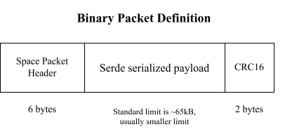

# Packet Format and TMTC Modelling

This chapter describes how TMTC packets look on the wire. It covers the CCSDS space packet format,
how to model the payload with Rust and `serde`, and how these parts form a protocol stack.

## Packet format

The CCSDS space packet protocol is a really simple protocol which just specifies a 6 byte primary
header that every exchanged TMTC packet has:


This is a protocol which already provides us with some useful fields:

- A packet type bit to distinguish telecommands from telemetry.
- ID field provided by the Application Process Identifier (APID). This can be used as an address
  or for packet multiplexing and demultiplexing.
- Basic sequence counter which can be used to determine missed packets.
- A data length field which specifies the length of the payload following the header.

Other than that, you are free to define the payload format yourself. It is a good idea to
append a [CRC](https://en.wikipedia.org/wiki/Cyclic_redundancy_check) checksum to the packet to
verify data integrity. There are many types of
[CRC codes](https://reveng.sourceforge.io/crc-catalogue/16.htm). A very common one in the space
domain is the 16-bit CRC-16-CCITT checksum, which is also called CRC-16-IBM3740.

However, what does the actual payload that we want to send to or from the satellite actually look
like? We recommend a payload format which is created with the excellent [`serde`](https://serde.rs/)
library. The following sections provide more information.

## Serialization

Serialization and deserialization is the process of converting (Rust) data structures into
some format which can be stored or transmitted. We can use this system for generating the payload
of our telecommand and telemetry packets. This allows us to model our payloads with Rust data
structures, fits perfectly into the data-driven approach that Rust programs tend to favor and
allows us to use the excellent type system.

A very common approach in the embedded domain is to manually pack primitive types like `u8`, `u16`
or `f32` into a buffer, usually in [big endian](https://en.wikipedia.org/wiki/Endianness) byte
order. This approach is interoperable with other languages, but it has some disadvantages:

- Bytes might have to be swapped on little endian CPUs. Copying the in-memory representation
  is not sufficient.
- The serialization code is hand-written. With many data structures, this code can be
  substantial and every line of it is a potential source of bugs.
- The deserialization code has to be written again for every other language that
  processes the data, for example a Python ground system.

The Rust ecosystem provides the [`serde`](https://serde.rs/) library for this task. The library
makes it trivial to add serialization support to custom data structures by providing a
[`derive`](https://serde.rs/derive.html) macro. In almost all cases, you can just add this derive
macro to a data structure to make it serializable with any `serde` compatible serializer.

There are various serializers available which are well suited to the requirements of space systems.

- Generally, we try to minimize the payload size to save data bandwidth.
- The data does not necessarily have to be human-readable

We recommend the [`postcard`](https://github.com/jamesmunns/postcard) serializer, which fulfills
these requirements and also works well for embedded systems.

## Modelling telecommands and telemetry

Using a serializer library like `serde` allows us to do some interesting things. For example,
let's assume you have a `Camera` object in software that you want to send some commands to.
This object should have the following capabilities:

- Process a ping command
- Capture an image
- Send back configuration data

You can now model a request to your `Camera` object using the following data structure

```rust,ignore
#[derive(Debug, serde::Serialize, serde::Deserialize)]
pub enum CameraRequest {
    Ping,
    CaptureImage,
    RequestConfig,
}
```

This data structure models all the requests that the `Camera` provides.
On the telemetry side, you would have a similar object

```rust,ignore
#[derive(Debug, serde::Serialize, serde::Deserialize)]
pub enum CameraResponse {
    Ok,
    Config(ConfigStructure)
}
```

where `ConfigStructure` would be some other wrapped configuration structure, and the `Ok` response
would be the reply for successful execution for all other commands which do not have additional
telemetry information.

Rust makes it trivial to move components into a new shared library. You can now put these data
structures in a shared `types` or `data` library which can be re-used by both a ground system
library and by the on-board software.

On the ground system, you could use a function like [`postcard::to_allocvec`](https://docs.rs/postcard/latest/postcard/fn.to_allocvec.html)
to generate the byte representation of a `CameraRequest`, which is then sent as the payload
inside a CCSDS space packet. On the on-board software side, you can use
[`postcard::from_bytes`](https://docs.rs/postcard/latest/postcard/fn.from_bytes.html) to deserialize
the `CameraRequest` from the raw payload bytes. In both cases, you do not need to hand-write
the serialization and deserialization code anymore. The only trade-off is that you need a Rust
conversion layer if you want to create your telecommands in another language like Python.

Using Rust structures like this also has other advantages. Once you have the `CameraRequest`
structure, you can `match` on it to cover **all** commands that the device handler needs to cover.
If you add a new variant, you have to handle it as well and you can not forget to handle a
variant.

One trade-off to keep in mind is that a Rust `enum` will always have the size of its largest variant
in memory. If you need to send large payloads to and from the on-board software, you can also
add this data as a secondary data blob behind the primary `serde` payload, and still send something
like small metadata as part of the payload. `postcard` can tell you the size of the deserialized
payload which helps with determining the size of any additional payload data.

We recommend this approach for all TMTC definitions where you control all sides of the communication.

## Protocol stack

We now have all the components required to build an application protocol which specifies how
our exchanged packets look on the wire.

The [OSI model](https://en.wikipedia.org/wiki/OSI_model) provides a good reference for how
a communication system might be structured. Not all layers are required for every link.

One simple solution on the application layer is a combination of CCSDS space packets, a `serde`
serialized payload and a CRC-16-CCITT checksum:



The `serde` serialized payload might also contain something like secondary headers, where we
can include common TMTC fields like telemetry timestamps or target/source IDs.

The following subsections cover the lower layers for different kinds of links.

### Simple point-to-point links

For simple point-to-point links like UART, it is often sufficient to only have a data-link layer
and an application layer. The
[COBS protocol](https://en.wikipedia.org/wiki/Consistent_Overhead_Byte_Stuffing) is an excellent
fit as a data-link layer. It is simple and libraries are available for Rust, C and Python.

COBS removes all zeros from a frame during encoding and restores them during decoding. The zero
byte can then be used as a frame delimiter in the data stream. Parsing frames only involves
scanning for the delimiters and decoding everything in between. If data is lost, the decoder
resynchronizes on the next delimiter. COBS is also computationally inexpensive and has a
deterministic worst-case overhead.

### Space links and the bridge to the communication subsystem

Many satellite systems use the lower OSI layers in addition to the application layer for the
space link. This oftentimes requires special hardware like dedicated FPGAs to handle forward error
correction fast enough. `sat-rs` might provide components to handle standards like the Unified
Space Data Link Protocol (USLP) in software, but most of the time the handling of communication is
performed through custom software and hardware. Still, connecting this custom software and
hardware to `sat-rs` can mostly be done by using the concept of TC sources and TM sinks from the
[communication chapter](./communication.md).
